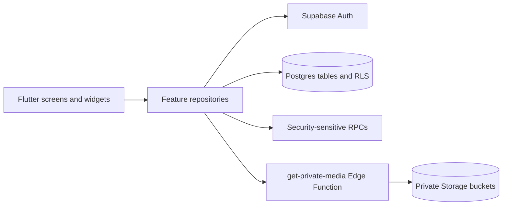

# Project Overview

## Purpose

Ilocano Teatro Master is a learning and cultural-content application for Ilocano language and theatre education. It gives students a guided space for lessons, quizzes, cultural stories, and creative theme submissions, while giving teachers tools to manage classes, review student work, provide feedback, and monitor progress.

## Intended users

- Students learning through assigned lessons, quizzes, stories, and creative tasks.
- Regular Teachers managing classes, assigned students, reviews, feedback, and profiles.
- Curriculum Editors, who are authorized Teacher accounts with additional curriculum-management permission.
- Teachers who manage assigned students, review submissions, generate class codes, and provide feedback.
- Project owners/administrators who provision teacher accounts and maintain Supabase configuration.

## Roles

Student accounts see student learning, Story Vault, Theme Builder, drafts, progress, notifications, and profile features. Regular Teacher accounts see the teacher dashboard, class-code management, assigned students, Review Queue, progress, notifications, and profile features. Curriculum Editor permission enables module, lesson, quiz, and Story Vault authoring and eligible deletion; it is an additional permission, not a separate login role.

## Core features

- Email/password authentication and session restoration.
- Role-based navigation for students and teachers.
- Student dashboard, profile, avatar handling, class-code joining, and progress.
- Published learning modules, structured or legacy lessons, reading progress, quizzes, and results.
- Story Vault stories, chapters, covers, illustrations, and reading progress.
- Six-step Theme Builder, draft persistence, submissions, feedback, revisions, and review decisions.
- Teacher curriculum, quiz, and Story Vault authoring for authorized editors.
- Review Queue with rubric scores, feedback, revision requests, and approvals.
- Notifications and private media delivery.
- Curriculum-editor-only deletion of eligible unpublished modules, lessons, quizzes, stories, and chapters, with server-side dependency and progress protections.

## Android and Web architecture

The client is a single Flutter application with shared Dart feature code. Flutter renders Android and Web interfaces; repositories isolate Supabase access; Supabase Auth, Postgres/RLS, Storage, RPCs, and the `get-private-media` Edge Function provide the backend.

## Scope and limitations

The documented product is the functionality present in the repository and verified evidence. Content quality, teacher provisioning, Supabase administration, signing-key custody, hosting, and Play Store policy work remain operational responsibilities. Lesson illustrations are not implemented in the current lesson editor/schema; Story Vault illustrations use private media. Android real-device and final Web client acceptance remain pending. The AI Writing Coach is excluded from the final scope and is not implemented or presented as an available feature.

## Evidence basis

This handover uses the existing client-readiness report dated 3 November 2026, repository tests, and the final checks recorded in [Testing & Acceptance Report](./06_TESTING_ACCEPTANCE_REPORT.md). Evidence is labelled as automated, live repository, live Web, Android device, or not verified.
