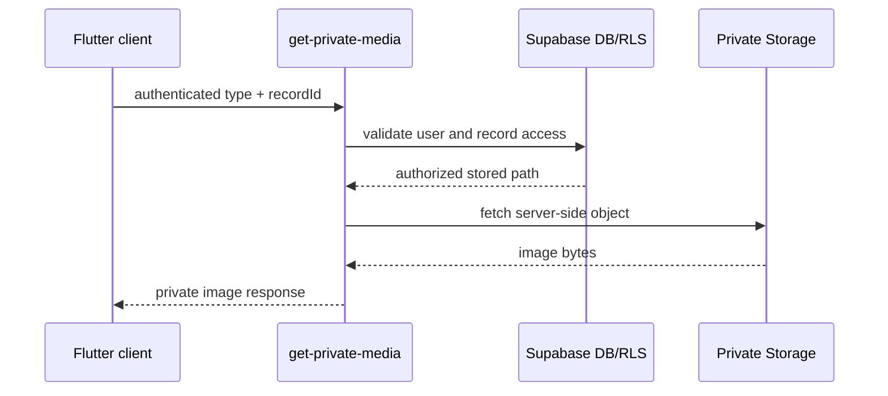

# Technical Documentation

## Stack and architecture

- Flutter/Dart application with shared Android and Web UI.
- Feature-first code under `lib/features`, shared widgets/storage under `lib/core`, and app setup under `lib/app`.
- Repository classes isolate Supabase calls from screens and models.
- `supabase_flutter` supplies Auth and database/storage clients; `file_picker` supplies uploads; `http` and Web interop support platform behavior.

## Backend services

Supabase provides password authentication, Postgres, Row Level Security (RLS), private Storage buckets, and RPC functions. The app uses a publishable key and project URL from non-secret build defines. Secret/service keys never belong in Flutter or Web output.

## Main tables and relationships

The implemented repositories reference:

- `profiles` — identity, role, editor permission, and avatar path.
- `teacher_students` — teacher/student assignments and class-code relationships.
- `learning_modules` → `lessons` → `lesson_progress`.
- `quizzes` → `quiz_questions` → `question_options` → `quiz_attempts`.
- `cultural_stories` → `story_chapters` → `story_reading_progress`.
- `theme_drafts` → `submissions` → `reviews` → `review_scores`.
- `rubric_criteria` — review scoring definitions.
- `notifications` — role/account event feed.

The exact column definitions and constraints are maintained in the SQL migrations and setup SQL; apply migrations through the approved Supabase process only.

## RLS and RPC access

RLS is the primary boundary. The application relies on server-side checks including `is_curriculum_editor()` and `can_review(uuid)`. Important RPCs referenced by the client include `reorder_module_lessons`, `get_quiz_editor_question_details`, `reorder_quiz_questions`, `submit_quiz`, `reorder_story_chapters`, `submit_theme`, and `complete_review`. The class-code migration uses server-side validation and revocation and does not grant direct unrestricted authenticated table access.

## Storage and private media

The known buckets are `ilocano-profile-avatars` and `ilocano-story-media`. The `get-private-media` Edge Function authenticates the bearer token, resolves the requested record through the caller's RLS-scoped client, validates the stored path and image signature, and fetches bytes using a server-side key. It supports avatar, story-cover, and chapter-illustration requests. It rejects malformed requests, unauthorized records, unsupported media, and oversized media without exposing database details or object paths.

## Environment configuration

Use a local, ignored `--dart-define-from-file` containing only the project URL and publishable key, or equivalent CI secret injection. The checked-in `supabase.local.json` is a local configuration reference and must not be copied into a public deliverable. Never expose `.env`, secret keys, test accounts, tokens, or keystores.

## Error handling and security

Repositories surface actionable errors to screens, preserve prior state on failed avatar replacement, and provide loading/empty/error UI in major flows. Keep production policies unchanged without approval. Review RLS, function JWT verification, storage policies, CORS, key rotation, and audit logs before release. Do not log credentials, bearer headers, private storage paths, or secret responses.

